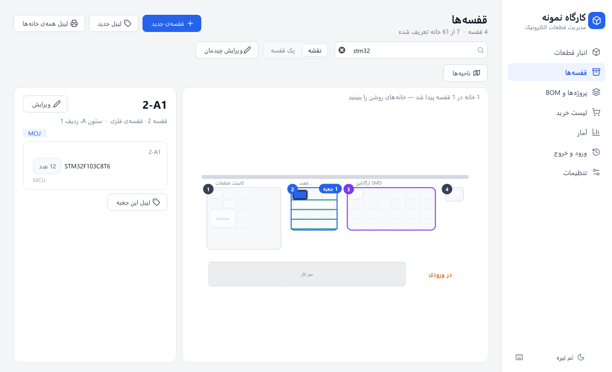
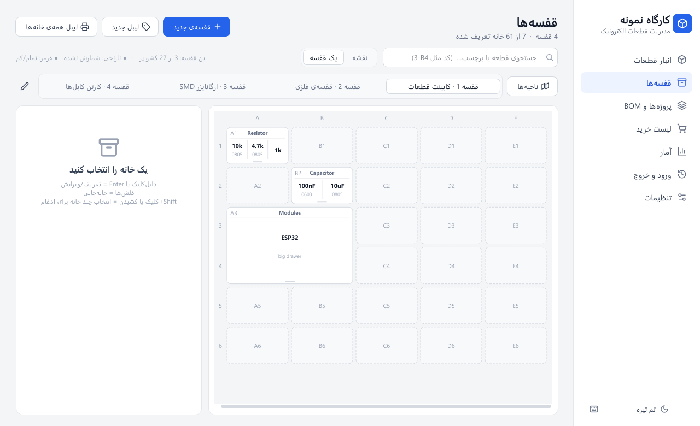
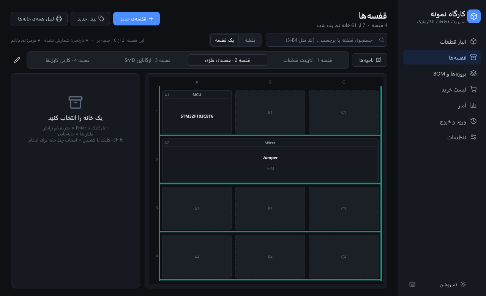
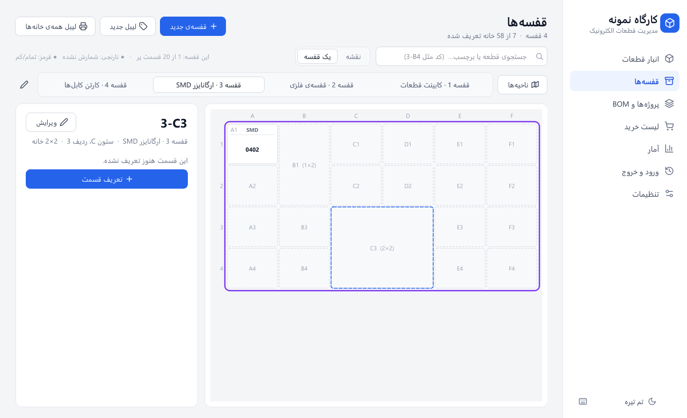
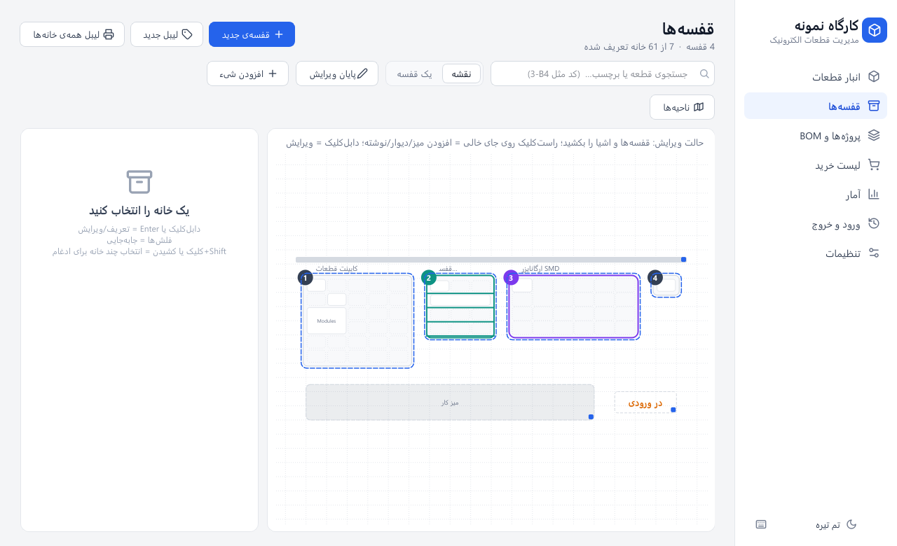

<div dir="rtl">

# انبار الکترونیک

برنامه‌ی فارسی و راست‌به‌چپ ویندوز برای انبارداری قطعات الکترونیک: موجودی، ورود و خروج، قفسه‌ها و جای دقیق هر قطعه،
پروژه‌ها و BOM، لیست خرید، برچسب و QR، ایمپورت از اکسل و آمار. با تم روشن و تیره.

**Anbar Electronic** — a Persian (RTL) electronic parts inventory app for Windows, built with Python and PySide6.



## دانلود و نصب

از بخش [Releases](../../releases/latest) یکی را دانلود کنید:

- **`AnbarElectronic-Setup-x.y.z.exe`** — نصب‌کننده (دسترسی مدیر لازم نیست؛ میانبر منوی استارت و دسکتاپ می‌سازد).
- **`AnbarElectronic-portable.zip`** — بدون نصب؛ باز کنید و `AnbarElectronic.exe` را اجرا کنید.
  اگر کنار exe یک فایل خالی به نام `portable.txt` بگذارید، اطلاعات هم کنار برنامه ذخیره می‌شود (مناسب فلش).

> ویندوز ممکن است هنگام اولین اجرا هشدار SmartScreen بدهد، چون فایل امضای دیجیتال ندارد:
> «More info» و بعد «Run anyway» را بزنید.

اطلاعات هر کاربر ویندوز در `%APPDATA%\AnbarElectronic` است (دیتابیس `warehouse.db` و عکس‌ها) و با حذف برنامه پاک نمی‌شود.
از «تنظیمات › اطلاعات و پشتیبان‌گیری» نسخه‌ی پشتیبان بگیرید یا روی کامپیوتر دیگری بازگردانی کنید.

## امکانات

- **انبار قطعات:** پارت نامبر، توضیحات، دسته، سازنده، پکیج، دیتاشیت، قیمت و تاریخچه‌ی قیمت، حداقل موجودی، عکس.
- **ورود و خروج سریع با کیبورد** (`+` ورود، `−` خروج، `=` شمارش) و تاریخچه‌ی کامل با موجودی قبل و بعد.
- **قفسه‌ها با چیدمان دلخواه** (پایین‌تر را ببینید).
- **پروژه‌ها و BOM:** کمبود قطعه برای ساخت چند عدد برد، و کسر خودکار از انبار.
- **لیست خرید:** کم‌موجودها و کمبود پروژه‌ها.
- **برچسب و QR** برای قطعه‌ها و خانه‌های قفسه.
- **ایمپورت از اکسل/CSV** و **آمار** (ارزش انبار، پرمصرف‌ترین‌ها، …).
- **دسته‌بندی دلخواه** با زیردسته.
- **اتصال اختیاری به [لیون الکترونیک](https://lionelectronic.ir):** خواندن سفارش‌ها از حساب شما و تکمیل خودکار
  اطلاعات، قیمت و عکس قطعه‌ها از سایت. بدون آن هم برنامه کامل کار می‌کند.

## قفسه‌ها

| | |
|---|---|
|  |  |

- **چهار نوع:** کابینت کشویی، قفسه‌ی طبقه‌ای (جعبه روی طبقه‌ها)، جعبه‌ی خانه‌خانه (ارگانایزر)، جعبه/کارتن تکی.
- **کد مکان:** `شماره‌ی قفسه-ستون‌ردیف-بخش`، مثلاً `3-B4-1` (ستون‌ها از چپ A، B، …؛ ردیف‌ها از بالا).
  هر خانه تا ۳ بخش دارد و با اسکنر QR یا تایپ کد پیدا می‌شود.
- **ادغام خانه‌ها:** Shift+کلیک یا کشیدن موس روی چند خانه، بعد راست‌کلیک › «یکی کردن»؛
  یا در پنجره‌ی خانه «اندازه» را تغییر دهید.
- **نقشه:** «ویرایش چیدمان» → قفسه‌ها را بکشید؛ راست‌کلیک روی جای خالی = افزودن میز، دیوار یا نوشته.
- **ناحیه‌ها:** برای هر اتاق یا انبار یک نقشه‌ی جدا. جستجو در همه‌ی ناحیه‌ها انجام می‌شود.

| | |
|---|---|
|  |  |

## اجرا از سورس

پایتون ۳.۱۱ یا جدیدتر:

```
pip install -r requirements.txt
python main.py
```

ساخت exe و نصب‌کننده: `build.bat` (برای نصب‌کننده، [Inno Setup 6](https://jrsoftware.org/isdl.php) لازم است).

## مجوز

[MIT](LICENSE). رابط کاربری با [Qt for Python (PySide6)](https://doc.qt.io/qtforpython/) ساخته شده که مجوز LGPL دارد.

</div>
